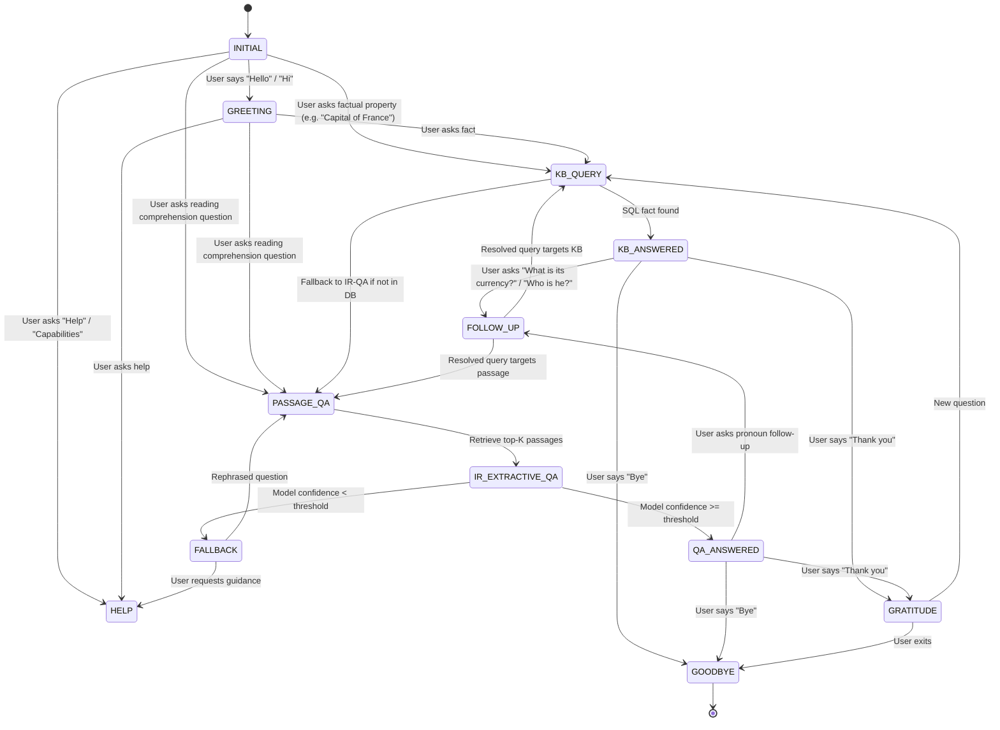

# Dialogue Flow, State Machine & Frame Design

## 1. Dialogue State Machine

The conversational assistant implements a finite-state dialogue manager supporting both chit-chat, structured knowledge retrieval, extractive reading comprehension, and anaphoric follow-up resolution.

---

## 2. Dialogue Frame & Slot Representation

To maintain context across conversational turns, the system uses a **Dialogue Frame** that stores the active discourse state:

| Slot Name | Data Type | Purpose | Example Value |
|-----------|-----------|---------|---------------|
| `active_state` | `str` | Current FSM dialogue state | `"KB_ANSWERED"` |
| `last_intent` | `str` | Intent identified in the previous turn | `"KB_QUERY"` |
| `current_entity`| `str` | Salient entity for anaphora resolution | `"Alan Turing"` |
| `last_topic` | `str` | Subject / attribute discussed | `"Enigma machine"` |
| `last_passage_id`| `str` | Document ID of the last retrieved passage | `"P01"` |
| `last_answer` | `str` | Last generated or extracted answer | `"June 23, 1912"` |
| `turn_count` | `int` | Number of elapsed user turns | `3` |
| `history` | `list` | Turn history with role, prompt, and response | `[...]` |

---

## 3. Anaphoric Pronoun Resolution in Follow-Ups

When a user submits a follow-up query containing personal or demonstrative pronouns (e.g. *he*, *she*, *it*, *they*, *him*, *her*, *that*):
1. The **Intent Classifier** detects the `FOLLOW_UP` pattern:
   - Pattern: `r"\b(who is (he|she)|what did (he|it) do|where is (it|that)|how tall is (it|he)|tell me more)\b"`
2. If `frame.current_entity` is populated:
   - Example Input: *"When was he born?"*
   - Active Entity: `"Alan Turing"`
   - Resolved Query: *"When was Alan Turing born?"*
3. The resolved query is then dispatched to the Knowledge Base or Extractive QA pipeline.

---

## 4. Multi-Turn Dialogue Traces

### Trace 1: Greeting -> Knowledge Base Factoid -> Pronoun Follow-up
- **Turn 1 (User)**: "Hello!"
  - **Intent**: `GREETING`
  - **System**: "Hello! I am your NLP Question Answering Assistant. How can I assist you with facts or text reading comprehension today?"
  - **Frame Entity**: `None`

- **Turn 2 (User)**: "What is the capital of France?"
  - **Intent**: `KB_QUERY` (SQLite lookup)
  - **System**: "**Paris**"
  - **Frame Entity**: `"France"` | **Frame State**: `"KB_ANSWERED"`

- **Turn 3 (User)**: "What is its official language?"
  - **Intent**: `FOLLOW_UP`
  - **Resolved Query**: "What is the official language of France?"
  - **System**: "**French**"
  - **Provenance**: `SQLite Table: facts | Entity: France | Attribute: official_language`

### Trace 2: Information Retrieval -> Extractive QA -> Insufficient Evidence Fallback
- **Turn 1 (User)**: "Who introduced the Transformer architecture?"
  - **Intent**: `PASSAGE_QA`
  - **Retriever**: Passage `P02` (Score: 0.548)
  - **Extractor**: DistilBERT -> *"Ashish Vaswani and colleagues"* (Confidence: 0.82)
  - **System**: "Ashish Vaswani and colleagues"

- **Turn 2 (User)**: "Who was the first person to walk on Pluto?"
  - **Intent**: `PASSAGE_QA`
  - **Retriever**: Best passage `P06` (Score: 0.08)
  - **Extractor**: DistilBERT (Confidence: 0.04 < threshold 0.15)
  - **System**: "I could not find sufficient evidence in the retrieved passages to answer this question with high confidence." (Prevents hallucination!)
